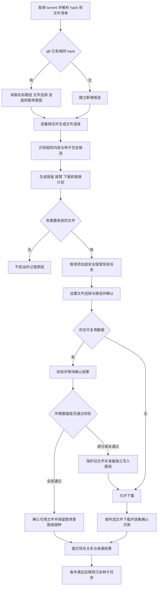

# Torrent 文件选择与已有数据复用设计

日期：2026 年 10 月 17 日；执行规则更新于 2026 年 10 月 18 日。

状态：第一至第四阶段已实现。第三阶段统一为一条下载流程，不提供复用开关或全量独立下载模式；第四阶段实现包含关系承接与冗余种子清理，以职责耗尽为退出的唯一依据。

1. **已有所需数据**：同 hash 直接接管；其他候选保持停止，完成映射与 recheck 后复用，不重复下载已确认完整的数据。
2. **没有所需数据，也没有待替换的低优先级版本**：直接在正式目标路径下载；准备阶段先确认文件选择和命名。
3. **没有所需数据，但已有低优先级版本**：先在 `{下载根}/.tasks/{taskId}` 暂存目录下载，旧版和现任关系在新文件完成前保持不动；完成后自动迁让冲突旧版、迁入新文件并逐集切换现任。

提交、文件身份、命名日志、占用检查与完成归档共用同一套实现。校验布局只生成和持久化一次，执行与恢复消费同一计划；候选与普通目标统一以下载根表达，不再维护另一套候选保存根模式。没有已知占用不再进入人工审批。只有身份异常、真实路径冲突或共享引用无法解除时才记录失败/归档受阻，处理后重试同一管线。

校验结果仍须绑定当前根、路径、大小和选择；不能用同名同大小冒充内容相同。校验失败后先保留原数据并取得独立写入位置，才允许重新下载；隔离是失败恢复步骤，不是可选择的下载模式。提交、改名、校验和启动的意图先于请求保存，崩溃恢复优先于普通完成判定。Checking 有超时，Moving 不能充当 Checking 证据，手动暂停意图始终保留。

验证范围：本地模拟会话、数据库迁移与编译测试。真实 qB 上的停止添加、改名到已有文件、recheck 结束后的停止语义仍需实测；不能把本地测试当作下载器真机验证。第四阶段（2026-10-19 实现）：包含承接以「已完成现任 + 双方承载正片同名同大小 + 占用者职责文件在大包清单中全部有对应 + 大包确有独有选中内容」为线索，翻转同内容平级的现任保留，内容确认交给复用校验，校验通过即逐集提前切换现任（不必等大包整包完成）；冗余清理以职责耗尽（登记表现任/待完成引用、选中内容被其他现任覆盖、人工固定资源、未清操作日志）为唯一退出条件，移除统一 deleteFiles=false，完成时间不再豁免。已实现边界：未完成占用者的同内容重叠沿用现任保留，不做部分数据承接；等价集合整包落选留墓碑不换包；较旧版本后完成不反向清理承接链；承接方被删除回退时旧任务复活为 Completed 但不自动重新添加种子（原始种子字节已保存，重加待后续需要）。

本设计围绕三个问题展开：每一集应该保留哪个版本，哪些 torrent 足以承载需要的文件，以及添加或接管种子时如何复用已有数据。目标是支持单集与合集混用、包内部分下载、合集替代小包，同时保留现有成片，减少重复下载与重复任务。

核心流程是：读取种子并取得 hash，查询 qBittorrent 是否已有任务，按集生成文件选择计划，处理种子间的包含关系，再执行暂停、命名、校验和启动。目标位置为空时可以直接使用最终命名下载；已有不同版本时，等新版本准备好后再替换。

## 设计范围与已确定方向

### 已确定的产品方向

| 议题 | 设计方向 |
| --- | --- |
| 同 hash 已存在 | 优先接管，先核对 qB 的当前文件路径与目标路径，不重复添加 |
| 同 hash 不存在 | 先择优，识别已有同组较低优先级资源，再决定下载与整理方式 |
| 添加新种子 | 采用暂停或停止状态添加，在准备完成后决定是否启动 |
| 提前命名 | 目标没有冲突时允许下载前使用最终文件名，不要求全部下载完成后才改名 |
| 已有数据复用 | 文件映射完成后执行校验，根据结果决定复用还是独立下载 |
| 多文件种子 | 每个文件可以下载或不下载，一个包允许部分胜出、部分落选 |
| 下载顺序 | qB 的普通、高、最高下载优先级不属于本次版本择优设计，选中文件使用普通优先级即可 |
| 包含关系 | 相同内容的文件集合存在完整包含关系时，倾向保留覆盖范围更大的种子 |
| 旧版本保护 | 未完成的新版本不应破坏已完成、可播放或仍被其他任务使用的文件 |
| 冗余种子清理 | 被完整包含，或全部必要文件已被择优替换后，自动从 qB 移除不再承担职责的种子；旧任务已经完成也不例外 |

“最大的种子”指包含更多相同内容、能够覆盖所需文件的种子，不按总字节数判定，也不以低质量大包取代高质量小包。

### 用于展开设计的建议默认值

下列默认值使流程可以具体描述，但仍属于实现前可调整的建议：

- 自动择优落选的文件设为不下载；已存在的文件不会因为取消下载而自动删除。
- 完全相同的文件集合优先沿用已有任务，避免反复迁移。
- 未完成旧资源可先停止继续下载，确认新任务已承接其职责后再移除旧种子。
- 已完成旧资源在新版本可用前继续保留；物理文件回收单独处理。
- 外部手动添加、尚未明确纳入 Banori 管理的种子可以作为占用与复用线索，不自动删除。
- 没有任何选中文件的候选不启动，保留可解释的落选或被覆盖结果。

### 范围边界

本设计不调整现有择优配置的含义，不把“分辨率更高”写成固定胜出规则，不引入跨站搬运、转码或自动生成新 torrent。

本轮只形成设计文档。数据库字段、接口名称、迁移方式及阶段名称均为后续实现方案，不是已存在的 API。文档中的自动暂停、删除种子和文件整理是拟议产品行为，不构成本次操作真实 qB、删除数据或执行发布的授权。

## 当前代码基础

源码基线为 `96365c9`。相关历史提交为 `39fc7c5` 和 `e097cf6`，均提交于 2026 年 10 月 16 日。

| 现有能力 | 代码入口 | 对本设计的意义 |
| --- | --- | --- |
| MonoTorrent 解析与 v1 hash | `Banori.Core/Torrents/TorrentDownloadPolicy.cs` | 继续作为原始元数据入口；目前拒绝纯 v2 种子 |
| qB 文件编号适配 | `TorrentDownloadPolicy.GetQbittorrentFileIndices` | 区分原始元数据顺序、库枚举顺序与 qB index |
| 原始路径与当前路径分离 | `Banori/Data/DownloadTaskFile.cs` | 接管已改名种子后仍能使用原名分类、解析和渲染模板 |
| 同 hash 查询与接管 | `Banori/Features/Downloads/DownloadService.cs` | 新增前先查询，响应丢失后也按 hash 对账 |
| 下载中提前整理 | `DownloadService.SettleNamingEarlyAsync` | 当前已经不是一律下载完成后才改名 |
| 文件核对与改名日志 | `Banori/Features/Downloads/DownloadFileService.cs` | 按路径与大小关联，保留操作日志并恢复未确认操作 |
| 包内同集版本择优 | `DownloadIntakeService.AnalyzeTorrentFiles` | 目前落选文件归入 Seed 分类，尚不等于设置 qB 不下载 |
| 统一候选择优规则 | `Banori.Core/Rules/Selection/CandidateRankingPolicy.cs` | 后续文件候选继续复用规则和现任保留语义 |
| 提交前占用检查 | `DownloadSubmissionPathValidator` | 目前主要比较数据库登记路径；不能当成已覆盖远端全部磁盘文件 |
| 单进程协调门 | `DownloadCoordinationGate` | 可用于短步骤的决策和副作用串行协调 |

当前仍缺少完整的“暂停添加、设置文件选择、命名、校验、按结果启动”准备阶段：

- `QbittorrentSession.AddTorrentAsync` 当前将 `PausedEnabled`、`StoppedEnabled` 设为 `false`。
- `IQbittorrentSession` 尚无文件下载选择和 recheck 接口；文件快照只包含 index、路径和大小。
- `TorrentSnapshot` 没有独立表示校验阶段；状态映射把 checking 状态合并进下载或做种类别。
- `DownloadTask` 的集数与替换字段仍主要是任务级，无法完整表达一个合集分别替换多个种子的部分文件。
- 当前包内择优未完整解决跨 torrent 的逐集竞争与包含关系。
- 文件整理对未登记外部种子存在同目标路径、同大小的放行分支；该条件只能提供复用候选线索，后续需接入内容确认。

文件编号历史核实见 [qBittorrent 文件 index 核实记录](QBITTORRENT_FILE_INDICES.md)。该记录的运行实测环境是 qBittorrent 5.2.4 和 libtorrent 1.2.20.0，不能直接代表所有版本和构建。

## 需要区分的对象

### 种子任务与媒体版本

种子任务代表一次 qB 下载、校验与做种活动，由 hash 识别。一个任务可以包含多个作品文件、多个集数和多个版本。

媒体版本代表某作品、某集的一组可用内容，通常由一个视频和明确关联的字幕等文件组成。版本择优作用于这个层面。种子的发布时间、标题和全包大小不能覆盖每个文件的实际解析结果。

物理文件是实际存储的数据。同一份物理数据可能被多个种子引用；取消下载、取消媒体展示、移除种子任务和删除物理文件是不同操作。

### 同集比较范围

至少以作品身份、媒体类型和集数区分候选；特别篇、小数集数、剧场版与正片不能只凭相同数字合并。字幕组、语言、修订版本等用于描述版本，并按配置参与择优。

本讨论中的“同组”指允许互相竞争的业务分组，不仅是字幕组名称相同。当前跨路径裁决还存在 `SiteSource` 同源限制和订阅治理豁免。第一阶段应保留这些已存在的边界，具体统一方式在实现前确认，不能借下放文件粒度静默扩大竞争范围。

### 四种不同身份

| 身份 | 用途 | 不代表什么 |
| --- | --- | --- |
| Torrent hash | 查询、去重、接管整个 qB 任务 | 不同 hash 不代表里面的视频一定不同 |
| 任务内部文件键 | UI、计划、日志中的稳定寻址 | 不直接等于 MonoTorrent 列表下标或 qB index |
| 每集版本身份 | 择优与媒体展示 | 同一集不代表文件字节相同 |
| 文件内容身份 | 已有数据复用与包含关系确认 | 不能仅由文件名、路径和大小证明 |

原始路径保持不变，当前路径随执行结果更新，目标路径来自当前计划。三者应同时可追溯，避免接管后丢失原始集数与版本信息。

## 必须保持的行为约束

1. 未完成准备的新增任务不开始有效网络下载；恢复时也遵守相同边界。
2. 用户暂停与系统准备暂停分开保存。系统只能恢复自己暂停且仍允许自动运行的任务。
3. 每集可以独立胜出或落选，不用一个任务级结果覆盖整个文件集。
4. 同名同大小不直接证明内容相同，不能据此删除旧种子或允许新数据覆盖旧成片。
5. 对共享旧文件的校验未通过时，新任务先取得独立写入位置，再下载或修复数据。
6. 删除种子任务与删除内容文件分开。包含关系收敛默认只移除冗余种子，保留物理内容。
7. 一个旧种子只要还有独有的必要文件或未完成的承接关系，就不能整体移除。
8. 对 qB 的变更先保存意图，再发请求，最后查询实际状态确认。请求成功不等于所有后续操作完成。
9. 有待恢复改名、移动或文件选择时，相关源路径与目标路径同时视为占用。
10. 自动完成与媒体现任切换必须基于当前计划、选中文件和校验状态，不能只看 torrent 总进度。

## 总体决策流程



包含关系可以先作为规划候选参与选包，但旧任务真正退出必须等待内容确认和数据承接。不存在“文件名看起来包含就先删小包”的步骤。

## 相同 hash 已存在

先查询 qB，读取当前保存根、文件路径、文件选择、进度、移动和校验状态。此查询覆盖上次添加成功但响应丢失，以及用户或其他工具已提前添加两种情况。

比较的是实际完整路径，不仅是 basename。内部文件键、qB index 和原始路径必须先可靠关联，不能按响应数组顺序猜测。

| 当前情况 | 处理方式 |
| --- | --- |
| 路径与目标一致，文件选择也一致 | 接管现有进度，不重复添加；无复用变更和校验疑点时不强制重检 |
| 路径一致，选择与计划不同 | 核对管理归属后调整选择，重新计算所需文件和完成状态 |
| 路径不同，目标为空 | 保存当前运行意图，暂停并确认，再调整命名或保存位置 |
| 路径不同，目标有候选数据 | 先检查占用和映射可行性，再进入校验复用流程 |
| 正在移动或校验 | 等待原操作稳定，不并发执行另一套路径计划 |
| 用户已经暂停 | 可以接管与分析，后续保持暂停；不得因为准备完成而自动启动 |
| 文件身份、路径或大小无法唯一对应 | 记录具体不一致项，停止该计划并进入待核对 |

已有文件的改名可能移动实际数据。目标已存在时不能把 qB 的 rename 操作当作无副作用的路径指针修改；需先确认目标处理能力，必要时使用独立位置验证。

相同 hash 的外部任务进入 Banori 管理后可以沿用其数据，但历史人工文件选择与手工路径覆盖应显式记录。接管不意味着可以静默丢弃用户保留的独有内容。

## 相同 hash 不存在

### 存在较低优先级资源

先按集与现任资源比较，再分别形成替换计划，不能仅根据“发现较低优先级 torrent”就淘汰整个旧包。

| 旧资源状态 | 新资源处理 | 旧资源处理 |
| --- | --- | --- |
| 未完成且没有其他保留职责 | 新任务暂停准备，判断旧数据能否复用；允许使用原始或独立路径下载 | 可先停止旧下载，确认承接后移除种子，内容暂留 |
| 未完成但还承担其他集 | 新任务只选择胜出集 | 旧任务只停止落选文件，其余继续 |
| 已完成且可播放 | 新版本在独立可写位置下载，完成后逐集替换 | 新版本可用前保留原成片与必要做种引用 |
| 已丢失或文件缺失 | 按新任务准备 | 历史关系不作为可复用数据证据 |

新 hash 在 qB 中不存在，不代表磁盘上没有对应内容。旧文件是否能用于新种子，仍由内容确认和校验结果决定。

### 没有较低优先级资源

先查看逐集结果：若已有更优版本，本次对应文件不下载；若没有现任，则属于补缺集；若只是相同内容的另一个载体，则进入包含关系或去重流程。

目标为空的选中文件可以直接按最终命名下载。有候选数据时暂停完成映射并校验。目标上存在不同版本时采用独立路径，不因为没有同组低优先级记录就认为磁盘为空。

没有复用候选时不必机械地强制全量 recheck；准备阶段仍需确认路径、文件选择和暂停状态。

## 每集择优与文件下载选择

### 生成选择计划

逐个解析视频文件，形成每集版本候选。包内与跨包使用相同规则配置快照，先确定每集需要哪个版本，再选择承载这些内容的 torrent。

沿用 `CandidateRankingPolicy` 的规则优先级、同字幕组修订版本和现任保留语义。分辨率是否允许由现有配置决定；示例里的升级关系必须以配置确实判定更优为前提。

| 文件角色或结果 | 下载选择 | 整理方向 |
| --- | --- | --- |
| 新增缺集或胜出版本 | 下载 | 目标为空时可直接最终命名；需要保护旧版时先独立下载 |
| 被更优版本淘汰 | 不下载 | 已有数据暂留，不自动删除，也不进入现任展示 |
| 相同内容由保留的大包承担 | 旧任务对应文件不再下载 | 等大包承接确认后调整引用 |
| 明确匹配胜出视频的字幕 | 随视频下载 | 保留语言与轨道后缀，避免多个字幕争用同名 |
| 无法确认关联的字幕或资源 | 待核对 | 不以同集数直接绑定到任意视频版本 |
| padding | 不作为媒体候选 | 遵循库和 qB 的编号适配，不作为包大小或覆盖优势 |
| 无法解析身份的文件 | 不参与自动版本竞争 | 保持可解释的待核对或既有保留策略 |

普通附件是否默认下载仍需确认。不能把当前 `Seed` 分类直接改成“不下载”：Seed 可能表示保留做种的附件，也可能表示包内择优落选，两者需要分开记录。

qB 的文件选择先只使用不下载与普通下载。高优先级、最高优先级和顺序下载不参与版本比较。协议参数见 [qB 文件内容与选择接口](https://github.com/qbittorrent/qBittorrent/wiki/WebUI-API-%28qBittorrent-5.0%29#get-torrent-contents)。

### 文件与集数不是始终一对一

一个视频覆盖两集时，它仍是不可拆分的物理文件。不能在同一文件里只下载其中一集，也不能默认当成两个独立文件替换。

多集区间、剧场版、特别篇以及同一包出现多个作品时，需要先确认比较范围。对于不能无歧义比较的重叠关系，保留现有可用版本并进入待核对，不自动推断切片或扩大替换范围。

### 同包混合结果示例

假设规则允许相关版本，且明确判定第 2 集新版本更优：

| 新包文件 | 已有资源 | 结果 |
| --- | --- | --- |
| 第 1 集版本 A | 已有更优版本 B | 不下载新包第 1 集 |
| 第 2 集版本 B | 已有较低优先级版本 A | 下载，准备好后替换第 2 集 |
| 第 3 集版本 B | 没有 | 下载，可使用最终命名 |
| 第 2 集对应字幕 | 匹配新视频版本 | 随第 2 集下载 |

该任务可以在部分文件没有下载时完成本次选择目标，不应被迫下载落选视频以满足整个 torrent 的总进度。

## 种子文件集合的包含关系

### 两种覆盖关系

业务覆盖表示两个文件都服务同一集；内容包含表示它们实际承载相同文件数据。前者用于择优，后者用于安全去重与种子承接，不能混为一个判断。

设 `F(T)` 为种子 T 中已确认内容身份的真实文件集合，不含 padding。若 A 的每个文件都能在 B 中找到相同内容对应，即 `F(A) ⊂ F(B)`，则 B 是 A 的严格超集，优先保留 B。

另外设 `R(A)` 为 A 仍需承担的文件，包括选中媒体、已保留附件与人工固定资源。只有这些职责都被可靠承接后，A 才能退出。包含候选可以依据文件清单先建立，但内容证据不足时不能把候选直接当作上述已确认集合。

### 包含判断与保留规则

| 关系 | 保留策略 |
| --- | --- |
| A 完整包含于 B，且质量选择未降级 | 倾向保留 B；承接确认后 A 退出 |
| A 与 B 的文件集合完全相同 | 优先保留现有可用任务；其他条件相同再用稳定标识决胜 |
| A 与 B 部分重叠，各有独有必要文件 | 都保留，按文件设置下载选择 |
| B 集数更多，但重叠部分是另一种压制 | 先按集择优，不能声称内容包含 |
| B 正片包含 A，但 A 有独有字幕或人工保留附件 | 保留 A 或先落实独有资源的独立保留方案，不整包删除 |
| 新小包包含于已有大包 | 由已有大包承担对应内容；若原来未选中这些文件，重新准备其选择计划 |

集合相同的种子先视为同一类，选择一个稳定代表，再处理严格包含。不要让等价集合互相淘汰，也不要因 RSS 返回顺序变化反复换包。

对多个部分重叠种子，本设计不求全局最少种子数，不引入通用集合覆盖优化。第一阶段只处理能够明确证明的等价与严格包含，保留有独有职责的任务。

### 文件相同的证据

作品、集数、字幕组、语言、分辨率、版本、原始文件名和大小用于缩小候选；内容等价需要更强证据。

优先通过已有数据在目标种子下的完整校验确认可复用性。若有明确的存储访问能力，也可以计算文件内容摘要。原生可靠的逐文件摘要可以作为证据，但不能假定所有 v1 torrent 都有这种字段。

v1 的 piece hash 对应种子布局中的数据分片，不是通用的逐文件摘要。不同包的 piece 长度、文件排列和边界可能不同，不能直接逐文件比较一段 piece hash 就断言内容相同。某个文件的边界分片缺少相邻数据时，也可能暂时无法确认；这种情况保留“未确认”，不直接认定文件不同。

新旧种子都没有实际数据、又缺少可靠内容证据时，可以记录候选包含关系并优先准备大包，但不能不可逆地丢弃小包来源和必要职责。来源信息与原始种子字节应保持可恢复。

### 大包承接小包的顺序

1. 建立 A 到 B 的逐文件映射，保留内容证据、独有资源和人工保留项。
2. B 已存在则接管；不存在则暂停添加。
3. 根据每集择优设置 B 的文件选择，不为“大包更大”而下载所有文件。
4. 安全映射或复制已有数据，完成必要校验；避免多个任务同时写同一份未完成文件。
5. 逐个确认 A 的必要文件已由 B 承担，并更新引用。
6. A 无独有必要文件、无待恢复操作且不再承担下载职责后，移除 A 的种子任务，保留数据。
7. 若 B 后续失败，未完成的承接不算成功；根据记录恢复或重新排队 A。

若 B 还需下载新集，但已经可靠承接 A 的全部旧集，不必等待 B 的所有新集完成才允许 A 退出。退出条件取决于 A 的职责是否已经承接，而不是 B 的整包进度。

## 路径规划与已有数据校验

### 目标路径分类

| 目标状态 | 命名与下载策略 |
| --- | --- |
| 未发现已有版本或其他写入计划占用 | 直接使用最终命名下载，无需人工审批 |
| 有可能相同的已完成文件 | 建立复用计划，保持停止，校验后决定 |
| 有不同版本的已完成文件 | 新版本独立下载，完成后替换 |
| 有其他任务正在写入 | 协调停止与数据交接，或改用独立位置 |
| 已有占用但身份或用途无法确认 | 阻止共享写入并记录冲突；不因缺少本地存储访问能力让所有新任务暂存 |

数据库任务、qB 中所有相关种子、未确认改名与移动路径，以及可访问存储上的未登记文件都可能构成占用。路径相同、父子冲突和目标重复需要统一检查。

隔离下载只需要保证实际写入路径不冲突，可以使用原始命名、任务专属目录或其他独立相对路径，并非必须重新采用某一种固定命名。只要目标可用，最终命名本身没有必要被推迟。

新增时还要检查 qB 最初看到的原始命名布局，而不只检查最终目标。文件选择和改名尚未应用之前，不能让初始路径先与旧文件冲突；必要时暂停添加到任务专属暂存根，完成文件计划后再切换。暂停添加用于控制执行顺序，不能代替路径占用检查。

### 存储访问能力

Banori 与 qB 可能运行在不同主机或容器中。qB 的绝对路径不能直接作为 Banori 进程的本地路径读取，Docker 挂载也不必然提供相同路径。

方案必须区分由 qB 执行的改名、移动、校验，与需要直接访问文件系统的复制、内容摘要、reflink 等操作。后者需要明确的存储路径映射和访问能力；没有该能力时，采用 qB 可完成的路径计划或独立下载，不声称支持任意跨目录数据复制。

### 校验执行与结果处理

校验前先保存计划，确认任务不会自动下载，并确认路径和文件选择实际生效。recheck 是异步阶段，需要观察校验状态及最终文件结果，不能用 HTTP 成功或某次总进度变化代替完成确认。

有复用候选时不使用跳过校验或直接假定完整的添加选项替代内容确认。校验结果只适用于当时的文件映射、布局和数据；后续路径、内容或文件选择变化需要判断哪些结果仍然有效。

底层 recheck 会重新读取数据并与 piece hash 比较；完成后的连接行为需要结合 qB 停止状态验证，不能假定发起校验后始终保持暂停。[libtorrent 校验语义](https://www.libtorrent.org/reference-Torrent_Handle.html#force_recheck)

| 校验结果 | 后续行为 |
| --- | --- |
| 所有必要数据已通过 | 确认对应文件可用，保留用户暂停意图，或进入允许的做种状态 |
| 部分通过，数据是本任务独占的未完成副本 | 从已确认数据继续补齐 |
| 部分通过，数据属于旧成片或共享文件 | 先隔离写入，再补齐；不能直接修复共享原文件 |
| 完全未通过 | 按不同内容或映射失败处理，保留旧数据，新任务独立下载 |
| 校验失败、结果不明或超时 | 停留在待重试或待核对，不启动可能破坏旧数据的下载 |

复制与写时复制可以提供独立修改能力，但需要实际文件系统支持。硬链接共享同一份可写数据，不能作为防止新下载改写旧成片的隔离手段。

qB 设置不下载不等于物理删除，也不能假设完全没有边界分片数据或辅助文件。选取的文件可能涉及跨文件分片；具体存储行为需要真实 qB 验证，不能把跳过文件重新选中来掩盖问题。相关文件选择与 partfile 行为见 [libtorrent 文件优先级说明](https://www.libtorrent.org/reference-Torrent_Handle.html#prioritize_files-get_file_priorities-file_priority)。

## 完成与媒体现任切换

### 三种完成状态

必须分别表达：所选文件下载完成、媒体版本整理可用，以及 torrent 全量完成。只下载 4 集的 12 集合集可以完成本次目标，但不能因此宣称整个 torrent 已经完整做种。

设当前计划的选中文件集合为 `W`。当 `W` 非空，且所选文件已被确认完整、没有未完成校验和待恢复路径操作时，才满足本次下载目标完成条件。`W` 为空表示无需下载或已被覆盖，不按空集合条件自动生成一次下载成功。

可用所选文件字节数计算展示进度：

```text
SelectedTotalBytes = sum(Size of selected files)
SelectedCompletedBytes = sum(verified completed bytes of selected files)
SelectedProgress = SelectedCompletedBytes / SelectedTotalBytes
```

真实实现可结合 qB 的逐文件进度与完成信息，但需确认其版本语义和校验期间行为。零字节文件不参与除法，单独确认存在性、路径和选择状态。可用性、下载量和对外可连接程度不是同一个指标。

### 逐集切换

一集的必要视频及已选配套文件完成、路径确认且没有阻塞校验后，可以独立切换为该集现任，不必等待同 torrent 的其他集完成。

更优的待下载候选与当前可播放现任分开保存。登记更优候选可以停止较低优先级未完成文件继续下载，但不能把已完成旧成片立即从现任展示中移除。

完成后替换仍沿用可恢复的路径日志。需要腾出目标时先保存旧文件的保留位置，执行后确认，再提交新现任关系。一个旧 torrent 中还有其他现任集时，仅改变被替换文件的关系，不将整个任务标记为无用。

Jellyfin 是否扫描到未完成文件需要独立处理。提前采用最终名称不等于提前发布为可播放版本，可根据部署能力使用未完成目录、临时后缀或扫描排除策略；具体方案需验证 qB 移动与复用路径是否兼容。

## 建议的数据模型变化

以下描述逻辑上必须持久化的信息，不要求逐项新增独立数据库表，也不预先确定最终字段名。

### 种子任务

继续保存 hash、原始种子字节、来源、当前保存根和时间信息。新增或扩展准备阶段、计划版本、规则版本、暂停原因、运行意图及所选内容进度。

当前 `IsUserPaused` 只覆盖人工暂停概念，后续需要防止系统准备暂停被对账误识别为人工暂停，也要防止系统错误恢复真正的人工暂停。外部操作使状态发生变化时重新确认运行意图。

### 任务文件

| 信息 | 用途 |
| --- | --- |
| 稳定内部键、原始路径与大小 | 不变的元数据关联 |
| 当前路径与计划目标路径 | 对账和执行 |
| 当前 qB index 或经核实的映射 | 设置文件选择，不能使用内部键直接调用 qB |
| 解析后的作品、集数、类型与版本信息 | 文件级择优 |
| 内容角色 | 视频、字幕、附件等，延续分类职责 |
| 是否选中及原因 | 下载或跳过，与内容角色分离 |
| 是否人工覆盖 | 保留用户选择和命名意图 |
| 文件进度、完成与校验结果 | 所选内容完成判定 |
| 内容证据及来源 | 复用和包含关系 |
| 改名、移动等待确认日志 | 崩溃恢复 |

### 每集现任与替换关系

需要独立记录每集当前可用版本、待完成优胜版本、对应视频与字幕文件，以及从哪些旧文件或任务承接。一个新任务可以替换多个旧任务的一部分，一个旧任务也可以被多个新任务分别接替。

因此，单个 `ReplacesTaskId` 和 `ReplacedByTaskId` 只能作为历史兼容或展示摘要，不能继续充当所有文件替换的唯一事实来源。

### 文件引用与包含承接记录

需要知道哪些任务或人工保留项仍依赖某个物理文件，并记录小包到大包的映射、待确认项和完成结果。第一阶段可以从现有文件记录与路径预留推导，不必立刻建设完整的全局内容寻址存储。

删除条件必须能回答：旧种子有没有独有职责，文件是否仍被引用，以及新任务是否已经确认承接。只保存一个“被哪个大包替换”的任务 ID 不足以恢复部分承接。

## qB 会话能力与执行阶段

### 需要补齐的会话能力

| 能力 | 需要观察的结果 |
| --- | --- |
| 停止状态添加 | 按 hash 找到任务，确认没有提前开始下载 |
| 读取文件选择、进度与完成信息 | 使用协议 index 关联文件，区分下载与跳过 |
| 设置文件选择 | 请求后查询实际选择，确认与计划一致 |
| 触发 recheck | 保存校验意图，并进入等待结果阶段 |
| 读取校验、排队、移动状态 | 校验或移动期间不执行冲突计划 |
| 暂停与恢复 | 观察有效状态，结合运行意图决定是否恢复 |
| 移除种子但保留数据 | 查询确认种子退出，内容不作连带删除 |

qB 5.x Web API 的文件选择通过 `filePrio` 设置，应用应使用文件接口返回的 `index`。接口名称和参数属于适配层，业务层只表达下载或跳过。[qB 文件优先级接口](https://github.com/qbittorrent/qBittorrent/wiki/WebUI-API-%28qBittorrent-5.0%29#set-file-priority)

文件选择和部分底层磁盘操作可能异步生效，不能仅根据写请求成功推进下一步。[libtorrent 文件优先级确认语义](https://www.libtorrent.org/reference-Torrent_Handle.html#prioritize_files-get_file_priorities-file_priority)

停止参数、暂停与启动方法需按 qB/API 版本适配。最低运行版本、所用 .NET 客户端 API 和实际服务器能力应在实现时核对，不在设计阶段假定所有版本相同。

### 建议的准备阶段

| 阶段 | 持久化内容 | 推进条件 |
| --- | --- | --- |
| 已规划 | 文件选择、目标、规则和计划版本、占用与承接关系 | 计划仍有效 |
| 添加或接管中 | hash、请求意图与运行意图 | 已找到并确认 qB 任务 |
| 等待停止 | 谁发起暂停、原运行状态 | 确认任务处于允许准备的状态 |
| 应用文件计划 | qB 文件映射、选择与路径变更日志 | 所有必要变更已确认 |
| 等待校验 | 校验对应的计划版本及请求记录 | 本次校验已确认结束且结果可解释 |
| 可运行 | 可写路径、选中文件、运行意图 | 用户未暂停且无阻塞操作 |
| 下载或等待切换 | 每文件进度和每集接替关系 | 必要文件可用 |
| 已满足选择目标 | 所选内容完成与整理结果 | 可继续做种或保持用户暂停 |
| 无需下载或被覆盖 | 决策原因与覆盖关系 | 不自动启动 |
| 待核对或失败 | 具体文件、步骤和错误 | 用户修正或有边界的重试 |

这些阶段可作为任务的准备子状态，不要求把每个阶段加入公开的 `DownloadTaskStatus`。关键是能够判断下一步和恢复条件，而不是建立通用工作流引擎。

## 并发与崩溃恢复

### 计划一致性

每次计划保存规则版本与计划版本。重新择优、用户编辑、发现外部文件变更或包含关系变化时，旧计划失效，必须重新核对。

生成决策、预留目标以及发起一个副作用步骤时进入协调范围，提交前重读相关文件和每集现任。新旧任务不能同时获得同一份共享数据的写入权。

校验与大文件移动可能耗时较长，不持续占用当前全局 `DownloadCoordinationGate` 等待结束。保存阶段和路径预留后退出，下轮对账短暂进入门内，核对实际结果和计划版本，再继续推进。

现有门禁仅提供单进程协调；不声明已经支持多个 Banori 实例同时管理相同数据库与 qB。外部手工修改无法被门禁阻止，因此执行前后仍要读取 qB 实际状态。

### 恢复规则

| 中断位置 | 恢复方式 |
| --- | --- |
| 添加成功但响应丢失 | 按 hash 查询并接管，不盲目重复添加 |
| 文件选择部分成功 | 读取实际选择，与保存计划比较，只补做缺项 |
| 部分文件已改名 | 依据日志的源路径、目标路径与大小识别结果，不重写原始身份 |
| 保存根移动未确认 | 源根和目标根都保留占用，等待实际位置稳定 |
| 校验请求结果未知 | 观察实际校验状态；无法确认已执行时不假定通过，必要时有边界地重试 |
| 校验后用户暂停 | 保留用户意图，不自动启动 |
| 新版本下载失败 | 保留旧现任，不宣布替换成功 |
| 大包只承接部分旧文件 | 小包保留剩余职责，不整体移除 |
| 移除旧种子成功但确认未落库 | 查询旧 hash 是否存在，确认退出，不重复执行带内容删除的操作 |
| 更新现任与远端整理结果不一致 | 依据日志完成或恢复，不能只恢复数据库就声称文件已回滚 |

重试要区分网络不确定结果、确定拒绝和文件身份冲突。后两者不能无限重复；界面应提供具体原因和重新规划入口。

## 种子清理与文件生命周期

### 自动移除不再需要的种子

种子已被完整包含，或其中所有必要文件都已被一个或多个更优资源替换，且没有其他保留职责时，自动从 qB 移除。该行为是已确定的设计方向，不再只是可选的清理建议。

| 情况 | qB 中的处理 |
| --- | --- |
| 候选所有文件均落选，且尚未添加 | 不添加，保留本地决策记录 |
| 已有种子所有必要文件都已被择优替换 | 确认替换完成后自动移除旧种子，保留内容 |
| 小包所有必要文件已被大包承接 | 确认承接完成后自动移除小包种子，保留内容 |
| 旧种子的不同文件分别由多个新种子承接 | 最后一项必要职责被承接后自动移除，不要求存在唯一的替代种子 |
| 只替换或承接了部分文件 | 保留旧种子及剩余必要文件的职责 |
| 所选文件已全部下载完成，但仍是现任资源 | 保留；无需继续下载不等于整个种子已无用途 |

旧种子已经下载完成、处于做种状态或具有完成时间，不单独构成阻止清理的条件。确认没有剩余职责后，已完成与未完成种子使用相同的退出判断。

0.1.2 的自动清理主要针对 `CompletedAtUtc == null` 的被替换任务，已完成旧任务通常只在数据库标记为被替换。本设计明确改变这一行为：新逻辑不能继续用“旧任务曾经完成”排除冗余种子清理。数据库保留历史记录与清理原因，不要求为了保留历史而继续保留 qB 种子。

### 清理时机与内容保留

移除一个旧种子前，需要确认它没有独有选中文件、没有仍需保留的附件、没有未完成的承接或操作日志，并且管理归属允许自动清理。对已经可播放的数据，还需确认新引用可以正常使用。

已完成旧资源在新版本尚未可用时继续保留；未完成旧资源可以先停止继续下载。满足上述退出条件后应执行清理，不因继续等待整包完成或继续保留旧版做种而无限延迟。

本设计收敛冗余种子时统一使用保留内容的移除方式，即 `deleteFiles = false`。已下载但落选的文件可以保留为历史数据或其他种子可复用的数据，其回收是独立策略，不夹带在择优和包含关系处理里。

每集被替换、torrent 不再承担下载、torrent 全量做种、物理文件可删除分别是不同状态。任务列表可以显示汇总结果，但底层不能用一个 `Replaced` 值代替所有事实。

## 界面与解释信息

任务详情应能够解释每个文件为什么下载或跳过、使用哪个路径、复用哪个来源，以及替换或被哪个资源覆盖。任务摘要应区分准备中、校验中、所选内容完成和全量做种。

建议至少展示：

- 已选文件数与总文件数，所选内容大小和下载进度。
- 每集的当前可用版本与待完成版本。
- 原始文件名、当前路径和目标路径。
- 文件跳过原因，例如已有更优版本、由更大合集承接、人工取消选择。
- 暂停原因，明确人工暂停与系统准备。
- 包含关系、承接进度和待核对的独有文件。
- 校验失败时受影响的文件与后续处理位置。

允许用户调整选择后，保存新计划版本并重新检查路径、校验和完成状态。变更只影响相关文件与集数，不让全包的已确认结果无理由全部重置。

## 建议的实施顺序

### 先补齐准备流程与文件选择

补充 qB 的停止添加、文件选择、文件进度和校验能力，区分校验状态与人工暂停。先实现没有旧文件冲突时的暂停准备、提前命名和按所选文件完成，保留现有任务级替换兼容路径。

### 再将跨包择优与替换下放到每集

建立每集可用现任与待完成候选，逐集生成下载选择。改造一对一任务替换关系，并明确字幕、合集区间、附件和人工覆盖的处理。不同入口复用同一决策逻辑。

### 接入已有数据校验与安全复用

按部署能力实现数据映射、校验确认及未通过后的独立写入路径。覆盖远端 qB 与 Banori 本地文件系统不同的部署，不假定任意磁盘文件都可读。

### 最后收敛明确的包含关系

在文件身份、选择、进度和引用可靠后，实现等价集合与严格包含的承接。先确认小包职责全部被承接，再移除旧种子。部分交集保留，不扩展为全局最优选包算法。

### 存量兼容

从原始种子与现有文件记录回填能够确定的信息。保留内部文件键、原始路径、人工覆盖和未确认日志；无法确定的内容不按名称自动推断。

历史任务的已完成状态先作为历史事实保留，按新模型逐步确认，不在升级时批量 recheck、改名、移除种子或删除文件。SQLite 与 MySQL 都需要配套迁移验证；旧任务级替换字段在兼容读取完成前不能直接丢弃。

## 验收场景

以下是后续实现的验收要求，不代表已经完成的测试结果。

| 场景 | 预期结果 |
| --- | --- |
| 新 hash，目标为空 | 停止添加、完成选择与命名后启动，不先下载一段原名数据再改名 |
| 同 hash，路径已匹配 | 不重复添加，沿用进度，无必要时不强制校验 |
| 同 hash，已有人工暂停 | 接管后不自动启动 |
| 同 hash，路径不同且目标为空 | 暂停确认后整理，原始文件身份保持不变 |
| 目标已有同名同大小但内容不同文件 | 不把大小当作通过证据，不改写旧成片 |
| 目标已有相同内容 | 校验确认后复用，避免重复网络下载 |
| 校验只通过部分共享数据 | 取得独立写入位置后补齐，旧数据内容不变 |
| 新版本优于未完成旧单集 | 可以停止旧下载，确认承接后清理旧种子，保留内容 |
| 新版本优于已完成旧单集 | 旧版持续可用，新版完成后再切换 |
| 一个新包有胜出与落选集 | 文件选择分别生效，不下载落选集来满足整包进度 |
| 只选 12 集合集中的 4 集 | 4 集及必要配套完成后满足目标，不宣称全量做种 |
| 一个旧包只有一集被替换 | 其他集继续存在和下载，不删除整个旧包 |
| 已完成旧种子的所有必要文件已被更优版本替换 | 自动移除旧 qB 种子，完成时间不阻止清理，内容保留 |
| 旧包的所有必要文件分别由多个新包替换 | 最后一项职责确认退出后自动移除旧种子，保留历史记录 |
| 已完成旧小包被大包可靠承接 | 自动移除旧小包，不沿用 0.1.2 对已完成种子的保留例外 |
| 一集含多个字幕 | 正确保留关联语言或轨道，不互相覆盖 |
| 跨集视频与单集文件重叠 | 不假定能够拆分视频，无法明确比较时待核对 |
| 小包严格包含于新大包 | 逐文件确认承接后移除小包种子，数据保留 |
| 大包新集尚未完成，但旧包职责已承接 | 可退出旧包，不强求大包全部完成 |
| 新小包包含于已有大包 | 使用大包，按需重新选择原来跳过的文件 |
| 文件集合完全相同 | 保留稳定代表，不因遍历顺序反复换包 |
| 两包部分重叠，各有独有集 | 都保留，分别选择必要文件 |
| 小包存在独有字幕或人工附件 | 不因正片被包含而删除全部种子职责 |
| 元数据包含 padding 与零字节文件 | qB index 映射正确，稳定内部键与人工覆盖不变 |
| v1 文件内容相同但跨文件边界不同 | 不因不可比的 piece hash 错误淘汰或误判内容 |
| 设置选择后立即查询仍未生效 | 等待确认，不提前启动 |
| 校验中 qB 返回旧进度或已完成快照 | 不提前切换现任或清理旧任务 |
| 准备期间用户暂停或修改选择 | 新意图优先，旧计划失效 |
| 添加、改名、移动、校验、移除后分别中断 | 重启后按日志与真实状态恢复，不重复破坏性操作 |
| 外部任务占用目标路径 | 纳入冲突检查，不仅依赖数据库登记 |
| Banori 与 qB 不共享文件系统 | 不误用远端路径做本地复制，按能力降级 |
| Jellyfin 定时扫描 | 未完成新版本不挤掉现有可播放版本 |
| 旧版 SQLite 与 MySQL 数据升级 | 身份与人工设置保留，无启动时批量远端清理 |

纯策略与恢复路径可以用单元测试及模拟会话验证；停止添加、文件选择、异步校验、重启、同路径改名和共享文件写入必须使用独立 qB 实例与生成的小型测试数据验收。不同 qB 和 libtorrent 构建分别记录，不用一次实测覆盖全部版本。

## 实现前需要明确的细节

| 事项 | 当前建议或边界 |
| --- | --- |
| 同组范围与跨来源竞争 | 先保留现有 SiteSource 和订阅治理边界，再明确如何统一到逐集模型 |
| 字幕配对 | 明确解析与原名匹配规则；无法唯一关联时待核对 |
| 普通附件选择 | 区分必要附件、可选附件和版本落选，不能复用 Seed 分类代替所有选择原因 |
| 人工修改的优先权 | 保留并标记人工意图；自动重算何时允许覆盖需要明确 |
| 包含关系的确认方式 | 已定：登记期同名同大小只作候选线索；内容确认复用目标种子校验（rename-onto + recheck），校验通过才切换现任；未启用校验能力时降级为独立下载、完成后按登记切换 |
| 多个非必要附件不同的包 | 已定：包含承接按正片职责判定，Seed 附件不单独构成职责也不参与超集判定；独有字幕作为职责阻断整包承接（保守保留小包） |
| 复用数据的复制能力 | 依部署路径映射选择 qB 操作、复制或写时复制；没有能力时独立下载 |
| 最低 qB 版本 | 核对停止添加、filePrio、校验状态与 .NET 客户端映射后确定 |
| 校验完成确认 | 明确处理快速校验、排队、重启及未观察到 checking 的情况，不能依赖单次采样 |
| 跳过文件与边界分片 | 真机验证选取结果、partfile 和重选行为，不以零额外数据作为承诺 |
| 未完成文件与 Jellyfin | 选择与现有目录布局兼容的临时存放或扫描策略 |
| 自动移除的管理边界 | 已定：仅移除数据库内任务（自建与接管一致），外部种子不自动删除；人工覆盖选中文件与未清操作日志（改名、归档待核对、校验、隔离）延迟退出；选择下推待办不阻塞退出 |
| 历史与内容回收 | 与择优分离；本设计不默认启用物理文件自动删除 |

## 参考入口

- [qBittorrent 文件 index 核实记录](QBITTORRENT_FILE_INDICES.md)：项目已有的编号源码核对与指定版本实测。
- [qBittorrent WebUI API](https://github.com/qbittorrent/qBittorrent/wiki/WebUI-API-%28qBittorrent-5.0%29)：文件快照、文件选择、停止、校验与文件操作的协议参考。
- [libtorrent torrent handle](https://www.libtorrent.org/reference-Torrent_Handle.html)：校验与文件选择的底层行为参考。qB 的最终运行表现仍以选定版本实测为准。
- `Banori.Core/Rules/Selection/CandidateRankingPolicy.cs`：规则比较、现任保留和稳定决胜。
- `Banori/Features/Downloads/DownloadIntakeService.cs`：登记、包内文件分析与现有任务级裁决。
- `Banori/Features/Downloads/DownloadService.cs`：提交、接管、提前命名、进度和完成对账。
- `Banori/Features/Downloads/DownloadFileService.cs`：文件身份、路径规划、占用与恢复。
- `Banori/Data/DownloadTask.cs` 与 `Banori/Data/DownloadTaskFile.cs`：当前持久化边界。
